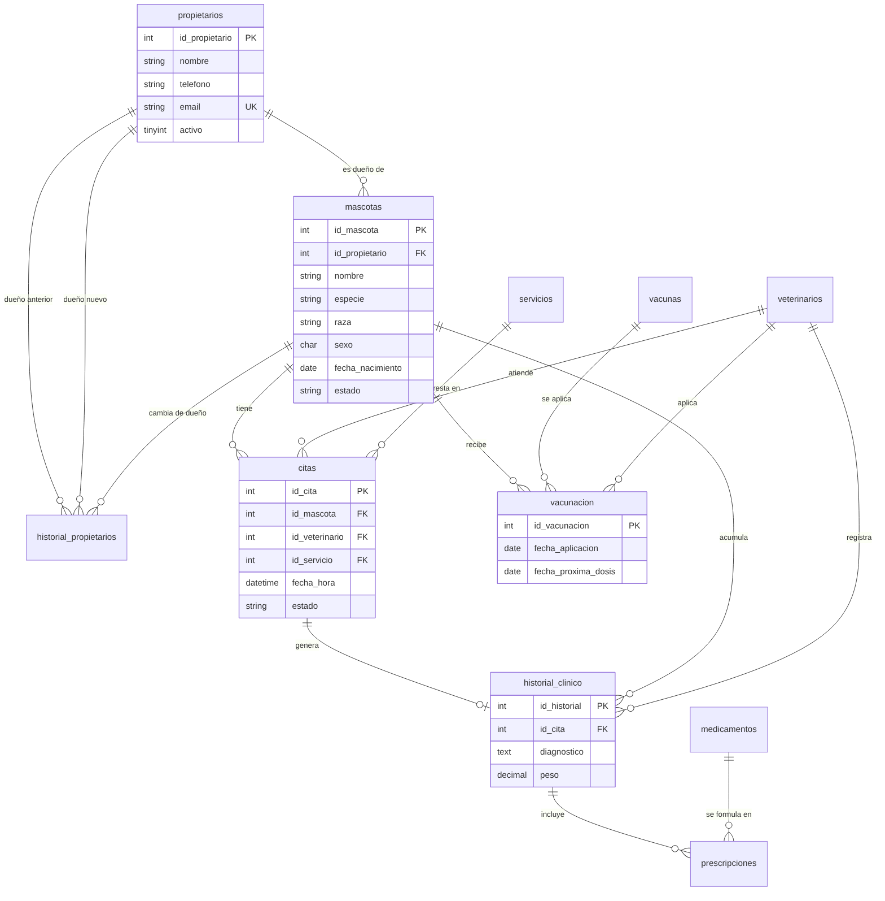

# MiMascota · Modelo de datos (BD1)

## 1. Modelo entidad-relación

El diagrama fuente está en `mer.mmd` (Mermaid).

## 2. Modelo relacional

Notación: **PK** en negrita, `→` indica FK.

- `bitacora` ( **id_bitacora**, fecha, tabla, id_registro, detalle, usuario )
- `citas` ( **id_cita**, id_mascota → mascotas(id_mascota), id_veterinario → veterinarios(id_veterinario), id_servicio → servicios(id_servicio), fecha_hora, estado )
- `historial_clinico` ( **id_historial**, id_cita → citas(id_cita), id_mascota → mascotas(id_mascota), id_veterinario → veterinarios(id_veterinario), fecha_registro, diagnostico, tratamiento, peso )
- `historial_propietarios` ( **id_cambio**, id_mascota → mascotas(id_mascota), id_propietario_anterior → propietarios(id_propietario), id_propietario_nuevo → propietarios(id_propietario), fecha_cambio, motivo )
- `mascotas` ( **id_mascota**, id_propietario → propietarios(id_propietario), nombre, especie, raza, sexo, fecha_nacimiento, estado )
- `medicamentos` ( **id_medicamento**, nombre, presentacion, stock, activo )
- `prescripciones` ( **id_prescripcion**, id_historial → historial_clinico(id_historial), id_medicamento → medicamentos(id_medicamento), dosis, cantidad )
- `propietarios` ( **id_propietario**, nombre, telefono, email, direccion, activo )
- `servicios` ( **id_servicio**, nombre, precio, descripcion, activo )
- `vacunacion` ( **id_vacunacion**, id_mascota → mascotas(id_mascota), id_vacuna → vacunas(id_vacuna), id_veterinario → veterinarios(id_veterinario), fecha_aplicacion, fecha_proxima_dosis, lote )
- `vacunas` ( **id_vacuna**, nombre, descripcion, intervalo_dias )
- `veterinarios` ( **id_veterinario**, nombre, especialidad, telefono, email, activo )

## 3. Diccionario de datos

### bitacora
Auditoría de cambios (p. ej. de precio).

| Columna | Tipo | Nulo | Default | Llave | Referencia |
|---|---|---|---|---|---|
| id_bitacora | int(11) AUTO_INCREMENT | No |  | PK |  |
| fecha | datetime | No | current_timestamp() |  |  |
| tabla | varchar(50) | No |  |  |  |
| id_registro | int(11) | No |  |  |  |
| detalle | varchar(255) | No |  |  |  |
| usuario | varchar(100) | No |  |  |  |

### citas
Agenda de citas por veterinario.

| Columna | Tipo | Nulo | Default | Llave | Referencia |
|---|---|---|---|---|---|
| id_cita | int(11) AUTO_INCREMENT | No |  | PK |  |
| id_mascota | int(11) | No |  | FK/índice | mascotas.id_mascota |
| id_veterinario | int(11) | No |  | FK/índice | veterinarios.id_veterinario |
| id_servicio | int(11) | No |  | FK/índice | servicios.id_servicio |
| fecha_hora | datetime | No |  |  |  |
| estado | varchar(15) | No | 'agendada' |  |  |

### historial_clinico
Un registro por cita atendida (Regla 3).

| Columna | Tipo | Nulo | Default | Llave | Referencia |
|---|---|---|---|---|---|
| id_historial | int(11) AUTO_INCREMENT | No |  | PK |  |
| id_cita | int(11) | No |  | UNIQUE | citas.id_cita |
| id_mascota | int(11) | No |  | FK/índice | mascotas.id_mascota |
| id_veterinario | int(11) | No |  | FK/índice | veterinarios.id_veterinario |
| fecha_registro | datetime | No | current_timestamp() |  |  |
| diagnostico | text | No |  |  |  |
| tratamiento | text | Sí |  |  |  |
| peso | decimal(5,2) | No |  |  |  |

### historial_propietarios
Registro de cada cambio de dueño (Regla 1).

| Columna | Tipo | Nulo | Default | Llave | Referencia |
|---|---|---|---|---|---|
| id_cambio | int(11) AUTO_INCREMENT | No |  | PK |  |
| id_mascota | int(11) | No |  | FK/índice | mascotas.id_mascota |
| id_propietario_anterior | int(11) | No |  | FK/índice | propietarios.id_propietario |
| id_propietario_nuevo | int(11) | No |  | FK/índice | propietarios.id_propietario |
| fecha_cambio | datetime | No | current_timestamp() |  |  |
| motivo | varchar(150) | Sí |  |  |  |

### mascotas
Mascotas; pertenecen a un único propietario a la vez.

| Columna | Tipo | Nulo | Default | Llave | Referencia |
|---|---|---|---|---|---|
| id_mascota | int(11) AUTO_INCREMENT | No |  | PK |  |
| id_propietario | int(11) | No |  | FK/índice | propietarios.id_propietario |
| nombre | varchar(60) | No |  |  |  |
| especie | varchar(30) | No |  |  |  |
| raza | varchar(60) | Sí |  |  |  |
| sexo | char(1) | No |  |  |  |
| fecha_nacimiento | date | No |  |  |  |
| estado | varchar(15) | No | 'activa' |  |  |

### medicamentos
Medicamentos con control de stock.

| Columna | Tipo | Nulo | Default | Llave | Referencia |
|---|---|---|---|---|---|
| id_medicamento | int(11) AUTO_INCREMENT | No |  | PK |  |
| nombre | varchar(100) | No |  | UNIQUE |  |
| presentacion | varchar(60) | No |  |  |  |
| stock | int(11) | No | 0 |  |  |
| activo | tinyint(1) | No | 1 |  |  |

### prescripciones
Fórmula médica: medicamentos de cada atención.

| Columna | Tipo | Nulo | Default | Llave | Referencia |
|---|---|---|---|---|---|
| id_prescripcion | int(11) AUTO_INCREMENT | No |  | PK |  |
| id_historial | int(11) | No |  | FK/índice | historial_clinico.id_historial |
| id_medicamento | int(11) | No |  | FK/índice | medicamentos.id_medicamento |
| dosis | varchar(100) | No |  |  |  |
| cantidad | int(11) | No |  |  |  |

### propietarios
Dueños de las mascotas (borrado lógico con `activo`).

| Columna | Tipo | Nulo | Default | Llave | Referencia |
|---|---|---|---|---|---|
| id_propietario | int(11) AUTO_INCREMENT | No |  | PK |  |
| nombre | varchar(100) | No |  |  |  |
| telefono | varchar(20) | No |  |  |  |
| email | varchar(100) | Sí |  | UNIQUE |  |
| direccion | varchar(150) | Sí |  |  |  |
| activo | tinyint(1) | No | 1 |  |  |

### servicios
Catálogo de servicios con su precio.

| Columna | Tipo | Nulo | Default | Llave | Referencia |
|---|---|---|---|---|---|
| id_servicio | int(11) AUTO_INCREMENT | No |  | PK |  |
| nombre | varchar(100) | No |  | UNIQUE |  |
| precio | decimal(10,2) | No |  |  |  |
| descripcion | varchar(255) | Sí |  |  |  |
| activo | tinyint(1) | No | 1 |  |  |

### vacunacion
Carné de vacunación y próxima dosis.

| Columna | Tipo | Nulo | Default | Llave | Referencia |
|---|---|---|---|---|---|
| id_vacunacion | int(11) AUTO_INCREMENT | No |  | PK |  |
| id_mascota | int(11) | No |  | FK/índice | mascotas.id_mascota |
| id_vacuna | int(11) | No |  | FK/índice | vacunas.id_vacuna |
| id_veterinario | int(11) | No |  | FK/índice | veterinarios.id_veterinario |
| fecha_aplicacion | date | No |  |  |  |
| fecha_proxima_dosis | date | No |  | FK/índice |  |
| lote | varchar(40) | Sí |  |  |  |

### vacunas
Catálogo de vacunas e intervalo entre dosis.

| Columna | Tipo | Nulo | Default | Llave | Referencia |
|---|---|---|---|---|---|
| id_vacuna | int(11) AUTO_INCREMENT | No |  | PK |  |
| nombre | varchar(100) | No |  | UNIQUE |  |
| descripcion | varchar(150) | Sí |  |  |  |
| intervalo_dias | int(11) | No | 365 |  |  |

### veterinarios
Profesionales de la clínica.

| Columna | Tipo | Nulo | Default | Llave | Referencia |
|---|---|---|---|---|---|
| id_veterinario | int(11) AUTO_INCREMENT | No |  | PK |  |
| nombre | varchar(100) | No |  |  |  |
| especialidad | varchar(60) | No |  |  |  |
| telefono | varchar(20) | Sí |  |  |  |
| email | varchar(100) | Sí |  | UNIQUE |  |
| activo | tinyint(1) | No | 1 |  |  |

## 4. Restricciones de integridad (resumen)

- **CHECK:** `activo IN (0,1)`, `precio > 0`, `stock >= 0`, `intervalo_dias > 0`, `sexo IN ('M','H')`, estado de mascota ∈ {activa, fallecida, adoptada}, estado de cita ∈ {agendada, atendida, cancelada}, `peso > 0`, `cantidad > 0`, `fecha_proxima_dosis >= fecha_aplicacion`.
- **UNIQUE:** `propietarios.email`, `veterinarios.email`, `servicios.nombre`, `medicamentos.nombre`, `vacunas.nombre`, `historial_clinico.id_cita` (garantiza 1 cita = 1 historial).
- **FK** con `ON DELETE RESTRICT`: ningún registro con historial se borra físicamente (Regla 5).
- **Índices:** `idx_citas_vet_fecha`, `idx_vacunacion_proxima`, `idx_mascotas_propietario`.

## 5. Normalización hasta 3FN

- **1FN:** todas las columnas son atómicas y no hay grupos repetidos. Los medicamentos de una atención no son una lista: van en filas de `prescripciones`.
- **2FN:** todas las tablas tienen llave primaria de un solo campo, por lo que ningún atributo depende de una parte de la llave.
- **3FN:** no hay dependencias entre atributos que no son llave:
  - nombre y teléfono del propietario viven solo en `propietarios`; `mascotas` guarda únicamente `id_propietario`;
  - el precio vive solo en `servicios`; `citas` guarda `id_servicio`;
  - `vacunas` separa el catálogo (nombre, intervalo) del hecho "se aplicó" (`vacunacion`);
  - `historial_propietarios` guarda el pasado; el dueño actual está en `mascotas`.
- **Decisión consciente:** `historial_clinico` repite `id_mascota` e `id_veterinario`, que también se deducen de `citas`. Se conserva para consultar el historial de una mascota sin pasar por `citas`; `sp_registrar_atencion` los copia siempre de la cita, así que no hay inconsistencia.
- **Limitación conocida:** `citas` no guarda el precio cobrado, por lo que la consulta 04 (ingresos) usa el precio vigente. Mejora posible: columna `precio_cobrado` en `citas`.

## 6. Reglas de negocio y dónde se cumplen

| Regla | Mecanismo |
|---|---|
| 1. Un único dueño; el cambio queda registrado | FK `mascotas.id_propietario` + disparador `tr_mascotas_au_propietario` |
| 2. Sin cruce de horarios por veterinario | `sp_agendar_cita` + disparadores `tr_citas_bi_cruce` y `tr_citas_bu_cruce` (ventana de 30 min) |
| 3. Cita atendida = un historial | `UNIQUE(id_cita)` + `sp_registrar_atencion` (transacción) + `tr_citas_bu_atendida` |
| 4. Sin vacunas futuras ni a mascotas inactivas | `tr_vacunacion_bi_validar` |
| 5. Sin borrado físico con historial | `ON DELETE RESTRICT` + `tr_mascotas_bd_proteger` + columna `activo` |
